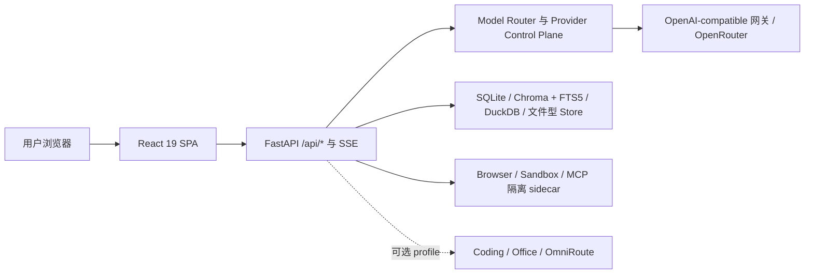
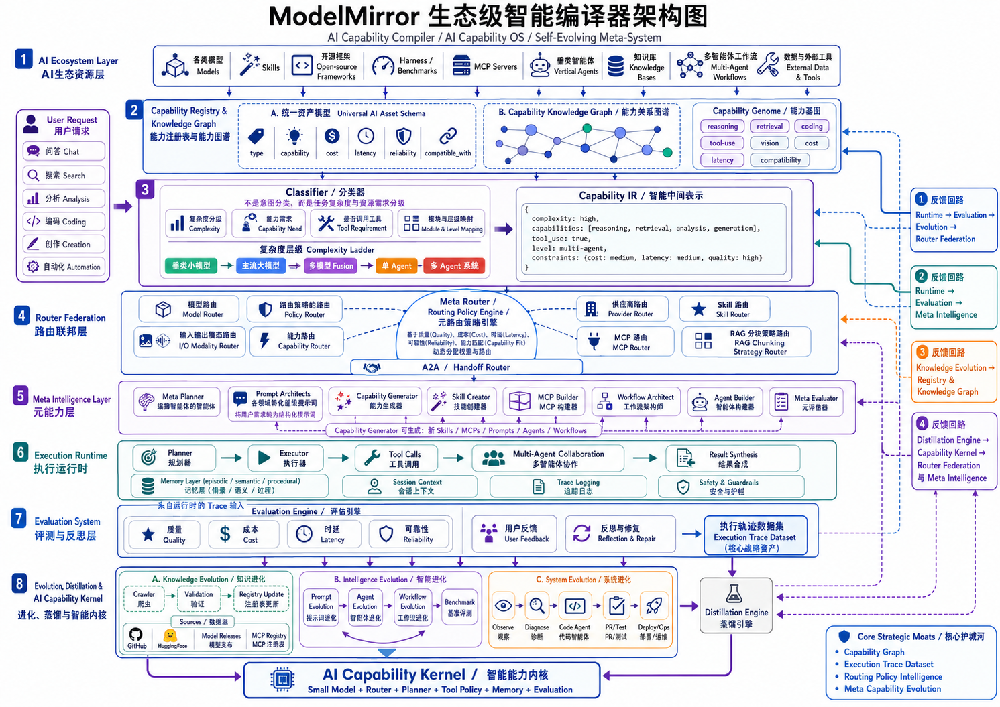

<div align="center">
  
  <h1>模镜 ModelMirror</h1>
  <p><strong> 从寻找一个模型，到编译一套智能。<br>
 From choosing a model to compiling intelligence.</strong></p>
  <p>
    面向中文用户的AI Capability OS生态级自进化工作台：以操作级 Provider Contract、精确 Workload Binding、<br />
    脱敏路由回执和隔离 Runtime，贯通资源发现、组合与受控执行。
  </p>
  <p>
    <a href="https://github.com/PinkElf-Elysia/ModelMirror/actions/workflows/quality.yml"></a>
    <a href="https://github.com/PinkElf-Elysia/ModelMirror/actions/workflows/multimodal-readiness.yml"></a>
    <a href="https://github.com/PinkElf-Elysia/ModelMirror/actions/workflows/file-readiness.yml"></a>
  </p>
  <p>
    <a href="docs/MODEL_PROVIDER_CONTROL_PLANE.md"></a>
    <a href="docs/MODEL_PROVIDER_CONTROL_PLANE.md"></a>
    <a href="docs/ARCHITECTURE.md#model-provider-control-plane"></a>
    <a href="docs/MODEL_PROVIDER_CONTROL_PLANE.md"></a>
    <a href="docs/architecture/ai-capability-compiler.md"></a>
  </p>
  <p>
    <strong>简体中文</strong> · <a href="README_EN.md">English</a>
  </p>
  <p>
    <a href="#快速开始">快速开始</a> ·
    <a href="#能力地图">能力地图</a> ·
    <a href="#当前架构">当前架构</a> ·
    <a href="#文档导航">文档导航</a>
  </p>
</div>

> [!IMPORTANT]
> 本文于 2026-11-07 按 `main@08d01eb5` 的源码、配置、测试定义、模块文档及已合并 PR 复核。文中的“可用”表示主分支存在可运行入口，不等于生产 SLA、企业级多租户能力或真实供应商端到端验收；依赖密钥、功能开关、可选 Compose profile、独立宿主或人工审批的能力会单独标记。本次是文档复核，不代表重新执行了全量测试、容器构建或付费 Provider 验收。

## 快速开始

项目提供 Docker Compose 隔离栈与本地开发两种方式。使用 Compose 需要 Git、Docker Desktop / Docker Engine（含 Compose V2），以及至少一种模型访问方式；当前基线的默认前端镜像存在下述构建上下文限制，也可按[本地开发与验证](#本地开发与验证)启动。

### 1. 准备配置

在仓库根目录复制服务端环境变量示例：

```powershell
Copy-Item server/.env.example server/.env
```

在 `server/.env` 中选择一种模型访问方式。最短路径是直接配置 OpenRouter：

```dotenv
OPENROUTER_API_KEY=your-openrouter-key
```

也可以连接任意 OpenAI-compatible 网关：

```dotenv
LLM_GATEWAY_URL=https://your-gateway.example/v1/chat/completions
LLM_GATEWAY_KEY=your-gateway-key
```

newAPI 采用独立 Compose 栈和显式网络 Overlay，不属于默认核心栈；配置方式见[快速上手](docs/QUICK_START.md)和[部署指南](docs/DEPLOYMENT.md)。

`server/.env` 用于后端凭据与服务配置；被 `docker-compose.yml` 的 `${...}` 显式引用的开关、Provider 管理配对密钥和主密钥，应通过仓库根 `.env` 或启动进程环境提供，否则会被 Compose 默认值覆盖。可参考根目录 [.env.example](.env.example)，不要提交真实 `.env`。设置页 Managed Provider 与普通环境网关是两条独立配置路径，保存连接不会自动启用托管执行。

### 2. 启动服务

以下是核心栈的标准命令。当前 `client/Dockerfile` 只接收 `client/` 构建上下文，但前端已引用 `experiments/ai-rpg-engine/card-replica/` 共享源码，默认配置尚未包含这些跨目录输入；不能把下面的 `--build` 视为已验证的一键部署。本地完整检出可按后文安装两处前端依赖，本文不修改镜像或部署配置。

```powershell
docker compose -p modelmirror up -d --build
docker compose -p modelmirror ps
```

默认 Compose 配置包含 Web、API，以及隔离的 Browser、Sandbox 和 MCP sidecar。OmniRoute、Coding、Office Host 与 newAPI 需要单独 profile 或独立栈；采用 Compose 部署 RPG 时另需 [RPG Overlay](docker-compose.rpg.yml) 与受控宿主，Matrix Oasis 和科研扩展也不是核心栈服务。部署仍以本地单租户为目标，不要直接把管理控制台暴露到公网。

### 3. 验证

```powershell
curl.exe http://localhost:8000/api/health
curl.exe http://localhost:5173/models
```

| 入口 | 地址 | 用途 |
| --- | --- | --- |
| 模型招聘会 | [localhost:5173/models](http://localhost:5173/models) | 浏览、筛选和试用模型 |
| 智能调度 | [localhost:5173/chat/auto](http://localhost:5173/chat/auto) | 查看路由策略与脱敏回执 |
| Agent Studio | [localhost:5173/agents/studio](http://localhost:5173/agents/studio) | 创建、版本化发布和运行 Agent |
| 元智能体 | [localhost:5173/agents/meta-agent](http://localhost:5173/agents/meta-agent) | 将目标编译为可审核、可编辑的候选工作流 |
| 评测与进化 | [localhost:5173/agents/evaluations](http://localhost:5173/agents/evaluations) · [localhost:5173/agents/evolution](http://localhost:5173/agents/evolution) | 固定版本评测与受控优化候选，依赖模型和资源配置 |
| 工作流 | [localhost:5173/workflow](http://localhost:5173/workflow) | 编排并运行 classic 工作流 |
| 知识库 | [localhost:5173/rag](http://localhost:5173/rag) | 构建、检索、评测和受控调优本地知识库 |
| RPG 故事馆 | [localhost:5173/rpg](http://localhost:5173/rpg) | 浏览角色卡与逐会话插件；游玩依赖独立宿主、资格和额度 |
| 帮助中心 | [localhost:5173/help](http://localhost:5173/help) | 按任务或模块查找教程、限制与排障步骤 |
| 设置 | [localhost:5173/settings](http://localhost:5173/settings) | 管理 Provider、路由、上下文与运行策略 |

更多路由与依赖边界见[当前系统架构](docs/ARCHITECTURE.md#稳定路由)。RPG 创作入口需单独配置 `VITE_RPG_AUTHORING_PORT` 并启动创作宿主，未配置时隐藏，详见[创作工作台](docs/ai-rpg-experiment/authoring/README.md)。

## 为什么是 ModelMirror

AI 供给已经从少数通用模型，扩展为模型、工具、知识库、Skill、MCP、垂类 Agent 与工作流组成的异构生态。真正困难的问题逐渐变成：一个任务需要哪些能力，如何在质量、成本、时延、可靠性与数据边界之间选择，以及如何验证组合结果。

ModelMirror 先把这条链路收敛到一个本地工作台：

1. **发现**：用中文目录、能力标签、价格与可用性信息找到候选资源。
2. **试用**：通过聊天和多模态工作区验证真实输入输出。
3. **组合**：把模型、工具、知识和 Agent 放入工作流或团队任务。
4. **治理**：用 Provider 策略、审批、回执、评测与运行诊断约束执行。

“AI 牛马招聘会”是面向用户的产品入口与体验隐喻；**AI Capability Compiler（AI 能力编译器）** 是目标产品引擎，不是对当前完成度的声明。

## 能力地图

| 能力域 | 当前主分支基线 | 成熟度 |
| --- | --- | --- |
| 模型目录与多模态聊天 | 持续维护的静态目录、价格与能力标签、OpenAI-compatible SSE；文本、图片、STT/TTS、音频、视频，以及结构化决策和摘要/字段提取专用工作区 | **可用 / Provider 依赖** |
| 路由与 Provider 治理 | `/chat/auto` 原生调度；逐 operation 目录、精确入口/形态/模型绑定、独立资格、持续准入、上下文预算、可信调用来源与脱敏 Receipt | **可用 / 分阶段门禁** |
| Agent 与专家团 | AI 人才市场、Agent Studio、Agent Workbench、Goal、Handoff、Automation、Agent App/API 与受控专家团组队执行 | **可用 / 部分执行需配置** |
| Meta Planner | Graph IR V3、22 类可编译节点、类型化资源绑定与 Headless Patch 预览/应用；视觉和表写入须单独授权，批准只写草稿 | **可用 / 显式授权与发布** |
| 评测与受控进化 | 固定数据集版本、资源快照与模型策略的 Benchmark 与对比评测、Prompt 和受限结构优化；写入评测仅用隔离表，优化候选须审核且不自动发布 | **可用 / 预算与证据门禁** |
| Classic Workflow | React Flow 画布、类型化 JSON 值、SSE、部署、审批、批处理与受控迭代；受支持的持久等待与顺序批量窗口可单实例跨重启恢复，HTTP、子工作流等高风险能力默认关闭 | **稳定主路径 / 高风险扩展受控** |
| 知识与 RAG | 版本化流水线、结构解析与转换回执、Chroma + 中文 FTS5 双索引、引用、评测、审批写入和证据约束的策略调优；候选需人工激活 | **稳定主路径 / 调优受控** |
| Data X 与数据表 | CSV/XLSX/Parquet 快照、DuckDB、语义模型、版本化指标、受限分析、提案审批与独立 Agent Table Schema/CRUD | **可用** |
| MCP、Toolset 与 Browser | 原生 stdio MCP 与隔离 sidecar；远程 OAuth/认证调用须经固定契约、复核和逐次审批；Toolset 支持 MCP、OpenAPI/OData 与内置 Provider | **可用 / 远程能力受控** |
| Skill、Prompt 与 Plugin | 目录、需求检索、安装、版本与本地导入；成功运行可经脱敏证据确认、Creator 和评测提炼为 Skill，接受与安装分开；另有版本化 Prompt 和声明式 Plugin | **可用 / 供应链与人工门禁** |
| Runtime 与可观测性 | Run、Checkpoint、租约、根预算、任务、Handoff、Goal 与调用回执；恢复保留取消及不确定状态，不以自动重发掩盖未知结果 | **可用 / 本地单实例为主** |
| RPG 故事馆与创作 | `/rpg` 角色卡、独立存档、逐会话插件、模型选择、历史/总结/记忆与消息工具；独立创作宿主支持草稿、固定发布版本和作品包导入导出 | **可选 / 宿主、资格与额度依赖** |
| Coding、workflow-native 与独立实验 | Coding V20 评测线、隔离工作流实验线、Matrix Oasis 3D Creator MVP 与独立文献研究工作台；不等于完整自主编程、游戏引擎或科研闭环 | **Experimental / 默认关闭或隔离** |

> [!NOTE]
> 目录在列、连接在线、认证通过与当前可调用是不同状态；静态目录不能替代运行时 Readiness。多模态 Managed 入口按各自协议和资格启用，不会因为合并代码就自动切换默认 Provider。测试通过也不替代付费模型、播放/下载、外部工具或真实数据的端到端验收；具体开关、预算和部署边界以各模块文档为准。

## 当前架构



| 层 | 主要技术 | 当前职责 |
| --- | --- | --- |
| Web | React 19、TypeScript、Vite、Tailwind CSS、React Router、React Flow | 资源目录、聊天与各类工作空间 |
| API 与 Runtime | FastAPI、Pydantic、httpx、SSE、MCP Python SDK | API 装配、执行、校验、路由与外部适配 |
| 数据 | SQLite、Chroma、FTS5、DuckDB、文件型 Store | 路由证据、知识索引、数据分析与本地运行状态 |
| 隔离边界 | Docker Compose、Unix socket、只读容器、受限网络 | Browser、Sandbox、MCP 和可选 Coding 执行面 |

当前 `/workflow` 与 `/rag` 均为 ModelMirror 原生主路径；Dify 只保留历史兼容代理和旧组件，不是默认启动或部署前提。newAPI 是独立可选数据面，ModelMirror 只通过显式 URL/Key 契约连接，不嵌入或代理其管理界面。

Meta Planner、评测与进化复用 NodeContract、classic runner 和 Authoring Proposal，不引入第二套可绕过审批的执行器。Provider 控制面负责精确准入与调用证据，公共上下文层约束外发预算；恢复继续校验可信调用来源，未知派发结果不得自动重发。RPG、Matrix Oasis 与科研扩展保留独立宿主/存储及各自授权边界，未包含在上图的默认核心栈中。

## 项目阶段与目标架构

| 层级 | 定义 | 代表内容 |
| --- | --- | --- |
| **Available Today** | 已合入主分支且具有可运行入口 | 资源目录、聊天、Classic Workflow、RAG、Data X、Agent Studio、Meta Planner、评测/进化入口、MCP/Skill 与帮助中心 |
| **Controlled / Optional** | 代码已合入，但依赖开关、profile、Provider、资格或审批 | Managed 多模态/Batch、受控表写入、远程 MCP、RAG 调优、Skill 经验提炼、RPG 宿主与创作、Coding 写回 |
| **Experimental** | 隔离实验或尚未完成生产门禁 | Coding V20 资格线、workflow-native、Matrix Oasis Creator/V2、科研扩展；V2 世界体验和科研后续阶段仍未开放完整声明 |
| **Target / Research** | 用于指导演进，不是当前功能承诺 | 跨生态 Capability Graph/Capability IR、Router Federation、平台级完整评测与自演进闭环 |



> 上图描述目标架构和长期研究边界，不表示所有层级已经交付。当前映射、成熟度和 Non-Goals 见[AI Capability Compiler 目标架构](docs/architecture/ai-capability-compiler.md)。

目标主链路是：生态资源进入统一 Registry 与 Capability Graph，用户目标被转换为 Capability IR，Meta Router 协调 Domain Router 生成执行计划；Runtime 负责安全执行，Evaluation 记录质量、成本、时延与可靠性信号，经过门禁的反馈再用于改进 Registry、策略和元能力。

当前 Graph IR V3、固定快照评测和受控进化是这条路线中已经落地的局部能力，不等于通用 Capability IR 或自主闭环已经完成。Planner 和优化器只能生成候选；批准、发布、安装与知识版本激活仍是相互独立的受控步骤。

## 本地开发与验证

本地全栈开发建议对齐当前 Quality CI：Node.js `24.18.0`、Python `3.12`；RPG 模块要求 Node `>=24.18.0 <25`、npm `>=11.16.0 <12`。前端 Docker 镜像仍使用 Node 22，服务镜像使用 Python 3.12，并为上游 Agent Worker 单独固定 Node 24.19.0，不能混同为全仓统一版本。模块导航见[开发者上手指南](docs/ONBOARDING.md)，实际版本以工作流和各模块锁文件为准。

后端（从仓库根目录开启独立终端）：

```powershell
cd server
python -m pip install -r requirements.txt
python -m uvicorn main:app --reload --host 0.0.0.0 --port 8000
```

前端（另开仓库根目录终端；主前端依赖 RPG 共享组件，两处锁文件都要安装）：

```powershell
cd client
npm.cmd ci
npm.cmd ci --prefix ../experiments/ai-rpg-engine/card-replica
npm.cmd run dev -- --host 0.0.0.0 --port 5173
```

提交前的主要门禁（以下两组命令分别从仓库根目录开始）：

```powershell
cd client
npm.cmd run typecheck
npm.cmd run test:run
npm.cmd run build
npm.cmd run verify:help-images
```

```powershell
npm.cmd ci --prefix experiments/ai-rpg-engine
npm.cmd ci --prefix server/orchestration_worker
npm.cmd run build --prefix server/orchestration_worker
npm.cmd run test:all --prefix server/orchestration_worker
python -B scripts/check_provider_coverage.py
python -m py_compile server/main.py
python -m pytest server/tests/ -q
docker compose -p modelmirror config --quiet
```

后端全量测试包含跨语言 RPG 合同与 Agency Worker 用例，不能只安装 Python 依赖。用户可见功能变更还需同步正式帮助内容，并在同一基线的独立预览中重放教程；具体要求见 [AGENTS.md](AGENTS.md#26-用户帮助中心与用户体验-pr-门禁)。请把前端构建、后端测试、Compose 配置检查与真实 Provider 冒烟分别记录；配置检查不等于镜像构建或功能验收，也不要从本工作树重建其他任务正在使用的共享栈。

## 文档导航

| 想了解什么 | 从这里开始 |
| --- | --- |
| 5 分钟启动与页面验收 | [快速上手](docs/QUICK_START.md) |
| 当前代码能证明什么 | [仓库事实基线](docs/REPOSITORY_FACTS.md) |
| 路由、数据流、存储和外部依赖 | [当前系统架构](docs/ARCHITECTURE.md) |
| Compose、可选 profile、备份和回退 | [部署指南](docs/DEPLOYMENT.md) |
| 模块文档与推荐阅读路径 | [文档中心](docs/README.md) |
| 普通用户教程、搜索与排障 | [本地帮助中心](http://localhost:5173/help) · [帮助内容维护说明](docs/help-center/README.md) |
| 模型目录、Provider 与调用边界 | [目录维护](docs/MODEL_CATALOG_MAINTENANCE.md) · [Provider 控制面](docs/MODEL_PROVIDER_CONTROL_PLANE.md) |
| 候选工作流、Graph IR 与受控写入 | [Meta Planner](docs/META_AGENT.md) · [Headless 编辑](docs/META_PLANNER_HEADLESS_AUTHORING.md) · [写入契约](docs/META_PLANNER_CONTROLLED_WRITES.md) |
| Benchmark、评测与候选进化 | [Benchmark](docs/BENCHMARKS.md) · [Evaluator](docs/EVOAGENTX_EVALUATOR.md) · [Evolution](docs/EVOAGENTX_EVOLUTION.md) |
| 知识内容合同与执行恢复 | [RAG 集成](docs/RAG_INTEGRATION.md) · [Runtime](docs/XPERT_RUNTIME.md) |
| RPG 游玩、插件与本地创作 | [故事馆教程](client/src/content/help-center/articles/play-rpg-cards.md) · [创作工作台](docs/ai-rpg-experiment/authoring/README.md) |
| 独立实验与能力边界 | [Matrix Oasis](experiments/matrix-oasis-engine/README.md) · [科研扩展](extensions/ai-research/README.md) |
| 产品叙事与长期方向 | [产品愿景](docs/VISION.md) |
| AI Capability Compiler 八层设计 | [目标架构](docs/architecture/ai-capability-compiler.md) |
| 开发护栏与验收要求 | [Harness Engineering](docs/HARNESS_ENGINEERING.md) |
| AI Agent 协作规则 | [AGENTS.md](AGENTS.md) |
| 第三方来源与归属 | [Third-party notices](THIRD_PARTY_NOTICES.md) |

本轮复核的代表性合并记录：[模型目录更新](https://github.com/PinkElf-Elysia/ModelMirror/pull/448)、[Provider 与可信来源](https://github.com/PinkElf-Elysia/ModelMirror/pull/419)、[Planner 受控写入](https://github.com/PinkElf-Elysia/ModelMirror/pull/403)、[持久执行内核](https://github.com/PinkElf-Elysia/ModelMirror/pull/415)、[RAG 内容合同](https://github.com/PinkElf-Elysia/ModelMirror/pull/368)、[RPG 创作](https://github.com/PinkElf-Elysia/ModelMirror/pull/438)与[会话历史恢复](https://github.com/PinkElf-Elysia/ModelMirror/pull/450)。PR 说明用于追溯增量，不替代当前代码、模块门禁或新的实测证据。

## 参与、支持与安全

- **参与开发**：先阅读 [AGENTS.md](AGENTS.md) 与 [Harness Engineering](docs/HARNESS_ENGINEERING.md)，保持改动小步、可验证、可回退，并运行与变更范围匹配的检查。
- **问题与建议**：请使用 [GitHub Issues](https://github.com/PinkElf-Elysia/ModelMirror/issues) 提交可复现问题或功能建议。
- **安全问题**：不要创建公开 Issue；请按[安全政策](SECURITY.md)使用 GitHub Private Vulnerability Reporting。

维护：模镜团队 · README 基线复核：2026-11-07（`main@08d01eb5`）
