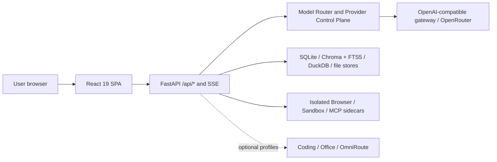
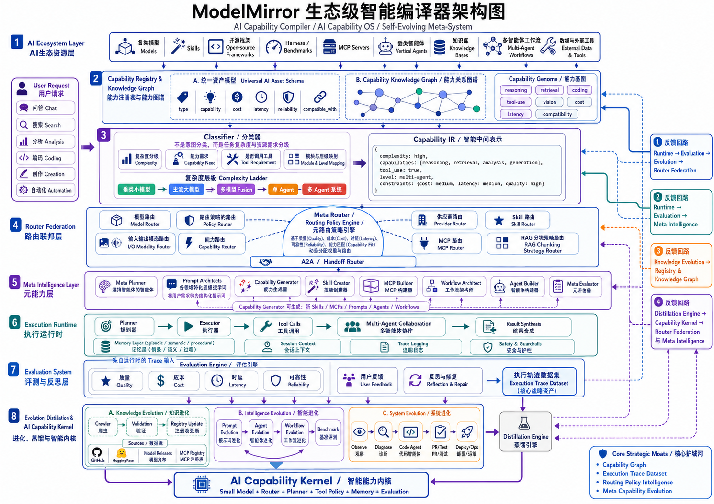

<div align="center">
  
  <h1>ModelMirror</h1>
  <p><strong>Explicit contracts, exact bindings, and auditable execution for heterogeneous AI workloads.</strong></p>
  <p>
    A local workspace built around operation-scoped provider contracts, exact workload bindings,<br />
    redacted routing receipts, and isolated runtimes—from discovery to controlled execution.
  </p>
  <p>
    <a href="https://github.com/PinkElf-Elysia/ModelMirror/actions/workflows/quality.yml"></a>
    <a href="https://github.com/PinkElf-Elysia/ModelMirror/actions/workflows/multimodal-readiness.yml"></a>
    <a href="https://github.com/PinkElf-Elysia/ModelMirror/actions/workflows/file-readiness.yml"></a>
  </p>
  <p>
    <a href="docs/MODEL_PROVIDER_CONTROL_PLANE.md"></a>
    <a href="docs/MODEL_PROVIDER_CONTROL_PLANE.md"></a>
    <a href="docs/ARCHITECTURE.md#model-provider-control-plane"></a>
    <a href="docs/MODEL_PROVIDER_CONTROL_PLANE.md"></a>
    <a href="docs/architecture/ai-capability-compiler.md"></a>
  </p>
  <p>
    <a href="README.md">简体中文</a> · <strong>English</strong>
  </p>
  <p>
    <a href="#quick-start">Quick Start</a> ·
    <a href="#capability-map">Capabilities</a> ·
    <a href="#current-architecture">Architecture</a> ·
    <a href="#documentation">Documentation</a>
  </p>
</div>

> [!IMPORTANT]
> Reviewed on November 7, 2026 against the source, configuration, test definitions, module documentation, and merged PRs at `main@08d01eb5`. “Available” means that the main branch contains a runnable entry point, not a production SLA, enterprise multi-tenancy, or real-provider end-to-end acceptance. Credentials, feature flags, optional Compose profiles, separate hosts, and human approvals are identified where required. This documentation review does not constitute a new full test run, container build, or paid-provider acceptance test.

## Quick Start

The project provides an isolated Docker Compose stack and a local development path. Compose requires Git, Docker Desktop or Docker Engine with Compose V2, and at least one model access option. The current default frontend image has the build-context limitation described below; alternatively, follow [Local Development and Validation](#local-development-and-validation).

### 1. Prepare the configuration

From the repository root, copy the server environment template:

```powershell
Copy-Item server/.env.example server/.env
```

Choose one model access option in `server/.env`. The shortest path is a direct OpenRouter connection:

```dotenv
OPENROUTER_API_KEY=your-openrouter-key
```

You can also connect any OpenAI-compatible gateway:

```dotenv
LLM_GATEWAY_URL=https://your-gateway.example/v1/chat/completions
LLM_GATEWAY_KEY=your-gateway-key
```

newAPI runs as a separate Compose stack connected through an explicit network overlay; it is not part of the default core stack. See the [Quick Start guide](docs/QUICK_START.md) and [Deployment guide](docs/DEPLOYMENT.md) for setup details.

`server/.env` supplies backend credentials and service settings. Flags, provider-admin pairing secrets, and master keys explicitly interpolated through `${...}` in `docker-compose.yml` must come from the repository-root `.env` or the launching process environment; otherwise Compose defaults override them. Refer to the root [.env.example](.env.example), and never commit real `.env` files. Managed providers configured in Settings are separate from the environment-based gateway: saving a connection does not enable managed execution.

### 2. Start the services

The commands below are the standard core-stack commands. Currently, `client/Dockerfile` receives only the `client/` build context, while frontend code imports shared sources from `experiments/ai-rpg-engine/card-replica/`. Those cross-directory inputs are not included in the default configuration, so `--build` must not be treated as a verified one-command deployment. A full local checkout can install both frontend dependency sets as shown later; this README update does not change image or deployment configuration.

```powershell
docker compose -p modelmirror up -d --build
docker compose -p modelmirror ps
```

The default Compose configuration includes the web app, API, and isolated Browser, Sandbox, and MCP sidecars. OmniRoute, Coding, Office Host, and newAPI require a separate profile or stack. Deploying RPG with Compose additionally requires the [RPG overlay](docker-compose.rpg.yml) and a controlled host; Matrix Oasis and the research extension are not core-stack services either. Deployment remains local and single-tenant: do not expose the management console directly to the public internet.

### 3. Verify the deployment

```powershell
curl.exe http://localhost:8000/api/health
curl.exe http://localhost:5173/models
```

| Entry point | URL | Purpose |
| --- | --- | --- |
| Model marketplace | [localhost:5173/models](http://localhost:5173/models) | Browse, filter, and try models |
| Smart routing | [localhost:5173/chat/auto](http://localhost:5173/chat/auto) | Inspect routing policies and redacted receipts |
| Agent Studio | [localhost:5173/agents/studio](http://localhost:5173/agents/studio) | Create, version, publish, and run agents |
| Meta Planner | [localhost:5173/agents/meta-agent](http://localhost:5173/agents/meta-agent) | Compile goals into reviewable, editable workflow candidates |
| Evaluation and evolution | [localhost:5173/agents/evaluations](http://localhost:5173/agents/evaluations) · [localhost:5173/agents/evolution](http://localhost:5173/agents/evolution) | Evaluate fixed versions and propose controlled optimizations; models and resources must be configured |
| Workflow | [localhost:5173/workflow](http://localhost:5173/workflow) | Compose and run classic workflows |
| Knowledge | [localhost:5173/rag](http://localhost:5173/rag) | Build, retrieve from, evaluate, and tune local knowledge bases under evidence gates |
| RPG story library | [localhost:5173/rpg](http://localhost:5173/rpg) | Browse character cards and per-session plugins; play requires a separate host, qualification, and budget |
| Help center | [localhost:5173/help](http://localhost:5173/help) | Find task- and module-based tutorials, limitations, and troubleshooting |
| Settings | [localhost:5173/settings](http://localhost:5173/settings) | Manage providers, routing, context, and runtime policies |

See the [current architecture guide](docs/ARCHITECTURE.md#稳定路由) for additional routes and dependency boundaries. The RPG authoring entry stays hidden until `VITE_RPG_AUTHORING_PORT` is configured and requires a separate authoring host; see the [authoring workbench](docs/ai-rpg-experiment/authoring/README.md).

## Why ModelMirror

AI supply has expanded from a few general-purpose models into a heterogeneous ecosystem of models, tools, knowledge bases, skills, MCP servers, vertical agents, and workflows. The harder question is no longer whether a model exists, but which capabilities a task needs, how to balance quality, cost, latency, reliability, and data boundaries, and how to verify the result.

ModelMirror brings that path into one local workspace:

1. **Discover** candidates through Chinese-first catalogs, capability tags, pricing, and availability signals.
2. **Try** real inputs and outputs in chat and multimodal workspaces.
3. **Compose** models, tools, knowledge, and agents into workflows or team tasks.
4. **Govern** execution with provider policies, approvals, receipts, evaluations, and runtime diagnostics.

The “AI Talent Fair” is the user-facing product entry point and experience metaphor. The **AI Capability Compiler** is the target product engine, not a claim about current completeness.

## Capability Map

| Capability area | Current main-branch baseline | Maturity |
| --- | --- | --- |
| Model catalog and multimodal chat | Maintained static catalogs, pricing and capability tags, OpenAI-compatible SSE; text, image, STT/TTS, audio, video, structured-decision, and summarization/field-extraction workspaces | **Available / provider-dependent** |
| Routing and provider governance | Native `/chat/auto` routing, per-operation catalogs, exact entry/shape/model bindings, independent qualifications, continuous admission, context budgets, trusted call origins, and redacted receipts | **Available / staged gates** |
| Agents and expert teams | AI talent marketplace, Agent Studio, Agent Workbench, goals, handoffs, automations, Agent App/API, and controlled expert-team planning and execution | **Available / some execution requires configuration** |
| Meta Planner | Graph IR V3, 22 compilable node types, typed resource bindings, and Headless Patch preview/apply; vision and table writes require separate authorization, and approval only updates drafts | **Available / explicit authorization and publication** |
| Evaluation and controlled evolution | Benchmarks and comparisons with fixed dataset versions, resource snapshots, and model policies, prompt and restricted structure optimization; write evaluations use isolated tables, and candidates require review without automatic publication | **Available / budget and evidence gates** |
| Classic Workflow | React Flow canvas, typed JSON values, SSE, deployment, approvals, batches, and controlled iteration; single-instance restart recovery covers supported durable waits and sequential batch windows, while high-risk HTTP and subworkflow features remain off by default | **Stable primary path / controlled extensions** |
| Knowledge and RAG | Versioned pipelines, structured parsing and transformation receipts, Chroma + Chinese-aware FTS5 dual indexes, citations, evaluation, approval-based writes, and evidence-gated strategy tuning; candidates require manual activation | **Stable primary path / controlled tuning** |
| Data X and managed tables | CSV/XLSX/Parquet snapshots, DuckDB, semantic models, versioned metrics, restricted analysis, proposal approval, and separate Agent Table schemas/CRUD | **Available** |
| MCP, toolsets, and browser | Native stdio MCP and isolated sidecars; remote OAuth/authenticated calls require pinned contracts, review, and per-call approval; toolsets support MCP, OpenAPI/OData, and built-in providers | **Available / remote capabilities controlled** |
| Skills, prompts, and plugins | Catalogs, needs-based search, installation, versions, and local import; successful runs can become skills through redacted-evidence confirmation, Creator, and evaluation, with acceptance separate from installation; versioned prompts and declarative plugins | **Available / supply-chain and human gates** |
| Runtime and observability | Runs, checkpoints, leases, root budgets, tasks, handoffs, goals, and call receipts; recovery preserves cancellation and uncertain outcomes instead of hiding them with automatic redispatch | **Available / primarily local single-instance** |
| RPG library and authoring | `/rpg` character cards, separate saves, per-session plugins, model selection, history/summaries/memory, and message tools; a separate authoring host supports drafts, immutable releases, and work-package import/export | **Optional / host, qualification, and budget-dependent** |
| Coding, workflow-native, and independent experiments | Coding V20 evaluation track, isolated workflow experiments, Matrix Oasis 3D Creator MVP, and a separate literature-research workbench—not complete autonomous coding, game-engine, or scientific-research loops | **Experimental / off by default or isolated** |

> [!NOTE]
> Catalog presence, an online connection, successful certification, and current invocability are different states; a static listing cannot replace runtime readiness. Managed multimodal entry points retain separate protocols and qualifications, and merging code does not switch the default provider. Passing tests do not replace end-to-end acceptance for paid models, media playback/download, external tools, or real data; module documentation defines the flags, budgets, and deployment boundaries.

## Current Architecture



| Layer | Main technologies | Current responsibility |
| --- | --- | --- |
| Web | React 19, TypeScript, Vite, Tailwind CSS, React Router, React Flow | Resource catalogs, chat, and product workspaces |
| API and runtime | FastAPI, Pydantic, httpx, SSE, MCP Python SDK | API assembly, execution, validation, routing, and external adapters |
| Data | SQLite, Chroma, FTS5, DuckDB, file-backed stores | Routing evidence, knowledge indexes, data analysis, and local runtime state |
| Isolation | Docker Compose, Unix sockets, read-only containers, restricted networks | Browser, Sandbox, MCP, and optional Coding execution planes |

`/workflow` and `/rag` are native ModelMirror primary paths. Dify remains only as a legacy compatibility proxy and old components; it is not a default startup or deployment dependency. newAPI is an independent optional data plane connected through an explicit URL/key contract; ModelMirror does not embed or proxy its management UI.

Meta Planner, evaluation, and evolution reuse NodeContract, the classic runner, and Authoring Proposals rather than adding an executor that bypasses approval. The provider control plane governs exact admission and call evidence; the shared context layer constrains outbound budgets. Recovery revalidates trusted call origins and must not automatically redispatch uncertain calls. RPG, Matrix Oasis, and the research extension retain separate hosts/storage and authorization boundaries; they are outside the default core stack shown above.

## Project Stages and Target Architecture

| Stage | Definition | Representative scope |
| --- | --- | --- |
| **Available Today** | Merged into the main branch with a runnable entry point | Resource catalogs, chat, Classic Workflow, RAG, Data X, Agent Studio, Meta Planner, evaluation/evolution pages, MCP/Skill, and the help center |
| **Controlled / Optional** | Merged code that still depends on a flag, profile, provider, qualification, or approval | Managed multimodal/Batch execution, controlled table writes, remote MCP, RAG tuning, skill distillation, RPG hosts/authoring, and Coding write-back |
| **Experimental** | Isolated experiments or capabilities without completed production gates | Coding V20 qualification, workflow-native, Matrix Oasis Creator/V2, and the research extension; full V2 world experiences and later research stages remain unqualified |
| **Target / Research** | A direction for system evolution, not a current feature commitment | Cross-ecosystem Capability Graph/Capability IR, Router Federation, and complete platform-wide evaluation and self-evolution loops |



> The diagram describes the target architecture and long-term research boundary. It does not mean that every layer has shipped. See the [AI Capability Compiler target architecture](docs/architecture/ai-capability-compiler.md) for implementation mapping, maturity, and non-goals.

The target path is: ecosystem resources enter a unified registry and Capability Graph; user intent is transformed into Capability IR; a Meta Router coordinates domain routers to produce an execution plan; the runtime executes it under guardrails; and evaluation records quality, cost, latency, and reliability signals. Only gated feedback may update registries, policies, and meta-capabilities.

Graph IR V3, fixed-snapshot evaluation, and controlled evolution are implemented parts of that direction, not proof that a general Capability IR or autonomous loop is complete. Planners and optimizers produce candidates only; approval, publication, installation, and knowledge-version activation remain separate controlled steps.

## Local Development and Validation

For full-stack local development, match the current Quality CI: Node.js `24.18.0` and Python `3.12`. The RPG module requires Node `>=24.18.0 <25` and npm `>=11.16.0 <12`. Frontend Docker images still use Node 22; the service image uses Python 3.12 and pins a separate Node 24.19.0 runtime for the upstream Agent Worker. There is no single runtime version shared by every component. See the [onboarding guide](docs/ONBOARDING.md) for module navigation; workflows and module lockfiles are authoritative for versions.

Backend, in a terminal opened at the repository root:

```powershell
cd server
python -m pip install -r requirements.txt
python -m uvicorn main:app --reload --host 0.0.0.0 --port 8000
```

Frontend, in another terminal opened at the repository root; install both lockfiles because the main frontend imports shared RPG components:

```powershell
cd client
npm.cmd ci
npm.cmd ci --prefix ../experiments/ai-rpg-engine/card-replica
npm.cmd run dev -- --host 0.0.0.0 --port 5173
```

Primary pre-submit gates, starting each command group at the repository root:

```powershell
cd client
npm.cmd run typecheck
npm.cmd run test:run
npm.cmd run build
npm.cmd run verify:help-images
```

```powershell
npm.cmd ci --prefix experiments/ai-rpg-engine
npm.cmd ci --prefix server/orchestration_worker
npm.cmd run build --prefix server/orchestration_worker
npm.cmd run test:all --prefix server/orchestration_worker
python -B scripts/check_provider_coverage.py
python -m py_compile server/main.py
python -m pytest server/tests/ -q
docker compose -p modelmirror config --quiet
```

The backend suite includes cross-language RPG contracts and Agency Worker cases; Python dependencies alone are insufficient. User-visible feature changes also require updated help content and tutorial replay in an isolated preview of the same baseline; see [AGENTS.md](AGENTS.md#26-用户帮助中心与用户体验-pr-门禁). Record frontend builds, backend tests, Compose configuration checks, and real-provider smoke tests separately. Configuration validation does not prove an image build or feature acceptance, and this worktree must not rebuild a shared stack in use by another task.

## Documentation

| Question | Start here |
| --- | --- |
| Five-minute setup and page acceptance | [Quick Start](docs/QUICK_START.md) |
| Facts that the current repository can prove | [Repository facts](docs/REPOSITORY_FACTS.md) |
| Routes, data flows, storage, and external dependencies | [Current architecture](docs/ARCHITECTURE.md) |
| Compose, optional profiles, backup, and rollback | [Deployment guide](docs/DEPLOYMENT.md) |
| Module documentation and recommended reading paths | [Documentation center](docs/README.md) |
| User tutorials, search, and troubleshooting | [Local help center](http://localhost:5173/help) · [Help-content maintenance](docs/help-center/README.md) |
| Model catalogs, providers, and call boundaries | [Catalog maintenance](docs/MODEL_CATALOG_MAINTENANCE.md) · [Provider control plane](docs/MODEL_PROVIDER_CONTROL_PLANE.md) |
| Workflow candidates, Graph IR, and controlled writes | [Meta Planner](docs/META_AGENT.md) · [Headless editing](docs/META_PLANNER_HEADLESS_AUTHORING.md) · [Write contract](docs/META_PLANNER_CONTROLLED_WRITES.md) |
| Benchmarks, evaluation, and candidate evolution | [Benchmarks](docs/BENCHMARKS.md) · [Evaluator](docs/EVOAGENTX_EVALUATOR.md) · [Evolution](docs/EVOAGENTX_EVOLUTION.md) |
| Knowledge-content contracts and execution recovery | [RAG integration](docs/RAG_INTEGRATION.md) · [Runtime](docs/XPERT_RUNTIME.md) |
| RPG play, plugins, and local authoring | [Story-library tutorial](client/src/content/help-center/articles/play-rpg-cards.md) · [Authoring workbench](docs/ai-rpg-experiment/authoring/README.md) |
| Independent experiments and capability boundaries | [Matrix Oasis](experiments/matrix-oasis-engine/README.md) · [Research extension](extensions/ai-research/README.md) |
| Product narrative and long-term direction | [Product vision](docs/VISION.md) |
| Eight-layer AI Capability Compiler design | [Target architecture](docs/architecture/ai-capability-compiler.md) |
| Engineering guardrails and acceptance requirements | [Harness Engineering](docs/HARNESS_ENGINEERING.md) |
| AI agent collaboration rules | [AGENTS.md](AGENTS.md) |
| Third-party provenance and attribution | [Third-party notices](THIRD_PARTY_NOTICES.md) |

Representative merged changes used in this review: [model catalog refresh](https://github.com/PinkElf-Elysia/ModelMirror/pull/448), [providers and trusted origins](https://github.com/PinkElf-Elysia/ModelMirror/pull/419), [Planner controlled writes](https://github.com/PinkElf-Elysia/ModelMirror/pull/403), [durable execution kernel](https://github.com/PinkElf-Elysia/ModelMirror/pull/415), [RAG content contracts](https://github.com/PinkElf-Elysia/ModelMirror/pull/368), [RPG authoring](https://github.com/PinkElf-Elysia/ModelMirror/pull/438), and [session-history recovery](https://github.com/PinkElf-Elysia/ModelMirror/pull/450). PR descriptions explain the changes; they do not replace current code, module gates, or new acceptance evidence.

## Contributing, Support, and Security

- **Contributing**: Read [AGENTS.md](AGENTS.md) and [Harness Engineering](docs/HARNESS_ENGINEERING.md) first. Keep changes small, verifiable, and reversible, and run checks proportional to the affected scope.
- **Issues and ideas**: Use [GitHub Issues](https://github.com/PinkElf-Elysia/ModelMirror/issues) for reproducible bugs and feature proposals.
- **Security**: Do not open a public issue. Follow the [security policy](SECURITY.md) and use GitHub Private Vulnerability Reporting.

Maintained by the ModelMirror team · README baseline reviewed on November 7, 2026 (`main@08d01eb5`)
