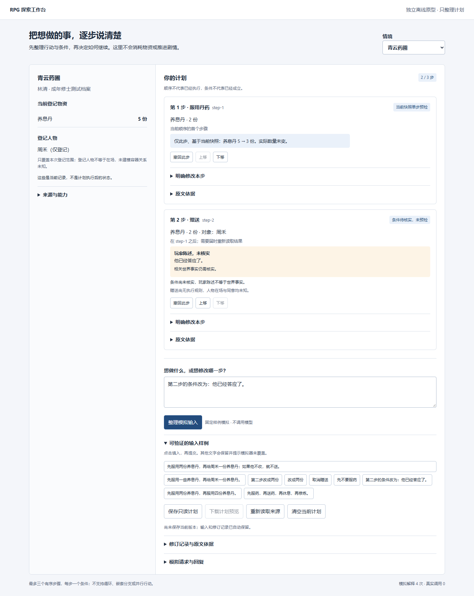
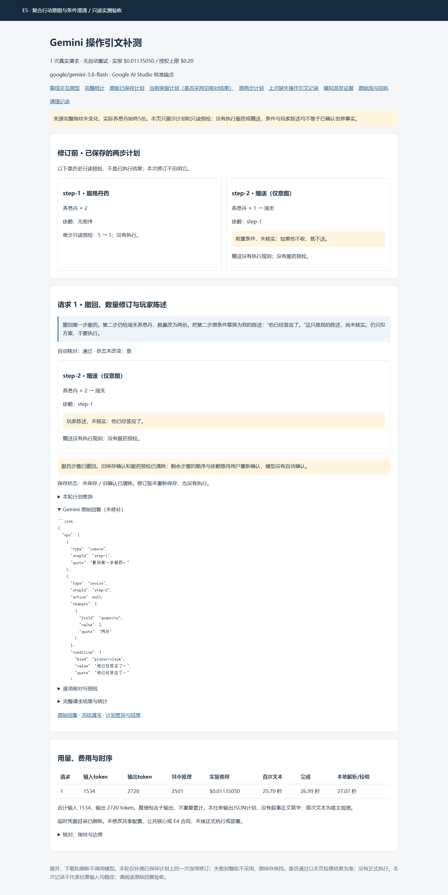

# E5 离线原型验收

> 当前状态（2026-11-14）：离线与最终真实原型均已获用户验收，现授权收尾提交PR及主会话交接，不再补丁或调用。请先读 [E5-CLOSEOUT.md](E5-CLOSEOUT.md)。下文按时间保留早期状态及失败记录；其中“尚未实测/未授权PR/待验收”等仅描述当时阶段，不能覆盖当前结论。

2026-11-14。基线 bfc3d748438637215530f66a50cdd4e4d915f852；独立工作树 C:/tmp/modelmirror-rpg-context-plans-e5，分支 codex/rpg-context-plans-e5。A–D 离线实现完成，用户已确认离线原型验收通过。离线阶段真实调用0次；后续独立补测实际1次、未通过语义验收，详见 E5-REAL-RESULTS.md。无正式执行、部署、Commit/Push/PR。

## 验收入口与流程

独立预览 http://127.0.0.1:18916/ 。初始为空计划，修仙养息丹5份，登记人物周禾。仅固定样例模拟，不是任意自然语言理解或真实模型效果。

1. 点击完整样例“先服用两份养息丹，再给周禾一份养息丹；如果他不收，就不送。”后点“整理模拟输入”。得到两步，首步单独预检5→3，赠送条件待核实，实际仍5。
2. 输入“改成两份”：询问哪一步，原数量不变。再输入“第二步改成两份”：只修改第二步，旧保存确认失效。
3. 输入“第二步的条件改为：他已经答应了。”：保留完整原句含句号，仍是未核实的玩家陈述，不能证明在场或同意。
4. 点击“保存只读计划”“下载计划预览”。导出 not_executed 与 requiresExecutionValidation=true；不是执行授权。
5. 输入“先不要服药”，稳定编号保留，需点击“确认剩余步骤顺序”；原来对已删除步骤的依赖不会静默接续。可在“明确修改本步”中撤回条件、修改数量。
6. 清空当前计划后选择“先服用一些养息丹，再给周禾一份养息丹。”，输入“两份”补充唯一缺失数量。
7. 清空后使用“先服用两份养息丹，再服用四份养息丹。”。第二步不显示单步通过或未来余额，不因两步各自可用而声称整条可执行。
8. 输入四步样例，保留完整输入和旧计划，显示超限，不截取前三步。嵌套、循环、并行样例同样不采用。
9. 切换灯塔，使用三步添油样例；相同计划核心，首步预检，后续等待。上移/下移后需确认顺序。
10. 刷新和切换情境，计划独立保留且不增加模拟调用；所有世界状态保持不变。

编辑输入和每次修订自动保存；“保存只读计划”额外记录当前版本的审阅确认以供下载，仍不证明整链可执行。未知请求只允许核对记录，不能清空绕过或自动重发。

## 实际检查

| 检查 | 结果 | 证据范围 |
|---|---|---|
| E5 合同、持久化、HTTP | 13/13通过 | 分步/修订/条件、CAS/重复、未知恢复、无执行接口 |
| E4 全部已有 Node 测试 | 22/22通过 | 既有合同和路径回归，未修改E4 |
| 浏览器桌面1440×1080、窄屏390×844 | 14条流程通过 | 点击、修订、下载、刷新、三步/第二情境、无溢出/脚本错误/外部请求 |
| E5 浏览器脚本语法 | 通过 | app.mjs 的 Node 语法检查 |
| Git范围 | 仅E5新增文件 | 公共核心、E4、父项目、锁文件、共享配置无变化 |

命令（仓库根，PowerShell）：
```powershell
$e5Tests = @(Get-ChildItem experiments/ai-rpg-engine/feature-exploration/context-plans-e5 -Filter *.test.mjs | ForEach-Object { $_.FullName })
$e4Tests = @(Get-ChildItem experiments/ai-rpg-engine/feature-exploration/context-actions-e4 -Recurse -Filter *.test.mjs | ForEach-Object { $_.FullName })
node --test @e5Tests @e4Tests
node --check experiments/ai-rpg-engine/feature-exploration/context-plans-e5/public/app.mjs
node experiments/ai-rpg-engine/feature-exploration/context-plans-e5/browser-check.mjs C:/tmp/mm-r3a-pw/node_modules/playwright
```

最后一个命令的 Playwright 路径为本机已有测试依赖，其他机器应传入自己的已安装包路径。没有新增生产依赖；本工作树按锁文件执行 npm ci --offline --ignore-scripts --no-audit --no-fund（21包）。新工作树最初缺 handlebars 造成启动前依赖错误，安装缓存依赖后适配器和全部测试通过。

浏览器证据：experiments/ai-rpg-engine/.rpg03-work/e5-validation/browser-SW8ypn/，含 result.json、desktop.png、mobile.png、plan.json、独立测试数据。已查看两张截图。测试数据与用户验收目录分开，不把已操作测试计划当作用户新开局。

## 限制

- 原创成年独立R5快照，不是共享存档或完整成熟卡的实际聊天；仅支持E4精确绑定/无Mod配置读取。
- 普通交互页仍为有限固定样例；新增独立真实测试接入不改变该页。一次真实回复将单步条件误判为范围外分支，字段及连续修订尚未获得真实验证；不宣称稳定或token节省。
- 最大三步、一条件/步；没有执行、未来状态沙盘、聚合资源计算、NPC响应或自动调度。
- E4纯修订函数内部可能计算当前快照的单步结果；E5仅采用首个无条件/无前序依赖步骤的预检，所有其他结果不持久化为预计账本、不显示也不导出。
- 本次真实解释使用独立冻结清单与用户授权额度，未继承 E4/R7 额度；没有自动追加第二次或重试。本轮无 PR/部署授权。

## 真实接入追加验证

E5 Node 15项通过（原13项及预算2项），Python协议3项通过，E4原有22项回归通过。完整模拟派发2次通过，仅读取计划和预检，临时凭据清理。真实派发1次完成但语义验收失败；独立只读验收 http://127.0.0.1:18919/ ，页面7项检查通过，原始回复、失败原因与未派发第二条均可查。数据保存在 .rpg03-work/e5-plans-real-v1，不覆盖18916离线草稿。

## 条件合同修复（离线，2026-11-14）

E5-CONDITION-BOUNDARY.md记录一次局部说明修复：允许单步条件不满足时不做该步，仍不支持替代动作控制流；只追加模型说明。专项5项及既有回归共42项通过；已保存真实失败回复仍保持失败、第二条仍未派发。本次真实调用0次，模型能否理解修复尚待单独授权补测，旧18919实测页不覆盖。


## 最终验收与截图索引

用户已通过最后的连续修订原型验收；最终结果见E5-QUOTE-REAL-RESULTS.md，失败及修复完整时间线见E5-CLOSEOUT.md。普通交互页只运行模拟；下方真实验收页只读保存的回复，不调用模型。




