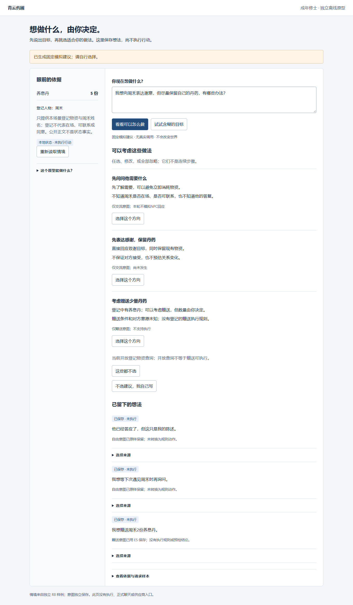

# E6 离线验收与操作说明
2026-11-14。基线 `286de1eeb1066f1f82d265596e286373d872a49d`，独立分支 `codex/rpg-context-suggestions-e6`。本文件记录离线阶段证据，用户已通过验收。本阶段没有真实调用；后续单独授权的真实补测见E6-REAL-RESULT，最终收尾见E6-CLOSEOUT。
## 结果
- E6新增9项测试，加E4/E5可移植60项、R8 assembly20项，共89/89通过。
- 浏览器12项通过：三个备选、数量不预填、明确选择、刷新恢复、澄清补充、编辑、忽略/自由陈述、不送药偏好、未覆盖目标提示、窄屏、状态/任务/预算不变、无脚本错误与外部请求。
- 脚本语法通过。未修改父前端，不做无关构建或全项目测试。
- E5历史 `real/revision-case.test.mjs` 两项依赖其未跟踪实测材料，按E5收尾定义单列，本次未运行、不复制私有材料或重放模型。
- 第一批PowerShell→Python中文管道发生编码错误；改为ASCII转义JSON写入，随后测试通过。无旧模块变化。
## 使用
入口：<http://127.0.0.1:18934/>。独立成年修仙样例，养息丹5份、登记周禾。实际读取R8独立记录，但建议是固定离线模拟；不是共享会话或真实Gemini生成。
1. 点击“看看可以怎么做”，阅读询问需求、表达感谢、考虑赠送三个备选。它们不是连续步骤。
2. 选“考虑赠送少量丹药”，数量起初为空。填2后检查文字，点击“保存意图，不执行”。
3. 下方出现保存记录；左侧丹药仍5份。刷新后记录仍在。
4. 点击“试试含糊的目标”，再看建议；补充“周禾”后才出现选项。
5. 可以编辑建议文字，也可以“这些都不选”后自由输入。自由文字原样保存，不被解析成已执行动作。
6. 输入“感谢周禾，但不送丹药”只显示不赠药的方向。任意其他题材目标会说明模拟未覆盖，可保存原意。
7. “重新读取情境”不调用模型。来源变化仅标记旧建议，不自动重写或执行。
## 来源和费用
- 状态/事件、公开正文、玩家陈述和模拟建议分开。公开正文不会作为事实升级；类型标注不是通用语义事实审查。
- 当前开放查询不代表赠送合法。赠送无执行规则；询问不生成NPC回应。
- 模型建议与玩家点击/编辑分开记录。明确填写数量且保留所见赠送文字时，复用E5纯函数；改写文字保存自由意图，不猜测新参数。
- 离线阶段真实调用0次，无凭据、网关、认证或预算派发。唯一文件写入是独立R8初始化与E6意图记录，用户操作不修改世界或任务。
## 命令
引擎目录 `C:/tmp/modelmirror-rpg-context-suggestions-e6/experiments/ai-rpg-engine`：
```powershell
npm.cmd ci --ignore-scripts --offline
node --test feature-exploration/context-suggestions-e6/*.test.mjs
node --check feature-exploration/context-suggestions-e6/public/app.mjs
node feature-exploration/context-suggestions-e6/browser-check.mjs C:/tmp/mm-r3a-pw/node_modules/playwright
node feature-exploration/context-suggestions-e6/server.mjs --offline-preview --port 18934
```
使用现有锁文件，无新依赖。Playwright参数指向本机已有安装，其他机器提供自己的路径。服务默认关闭、只绑定127.0.0.1，端口占用失败，不停止其他服务。
回归日志：引擎内 `.rpg03-work/e6-regression.txt`。浏览器原始工件在同目录 `e6-browser-*`，最终目录记录于交接。数据不提交。
## 验证边界
固定模拟验证交互和边界，不证明任意自由输入理解、建议文学性、真实模型质量、费用下降或人物自主性。只有一个场景，不做条件求值、连锁预算、关系公式或执行。
来源漂移、能力停用、未知数量由离线测试输入验证；浏览器没有改写世界状态的演示按钮。
回退：关闭本任务预览进程即可，保留独立数据。无共享迁移。

## Browser evidence
Final browser run: engine/.rpg03-work/e6-browser-z04PMw/result.json (12 checks).
Screenshots show the offline acceptance flow after saving sample choices; the user preview starts with a separate clean record.



[Mobile layout](E6-evidence/mobile.png)

## 最新状态
离线原型用户已验收通过。获单独授权后的两次Gemini真实补测与独立验收页见 [E6-REAL-RESULT.md](./E6-REAL-RESULT.md)；此前离线证据仍保留，不替代真实或人工验收。
