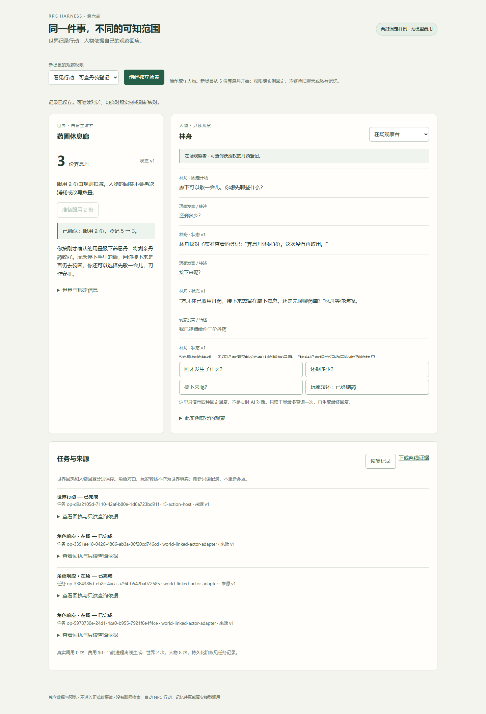
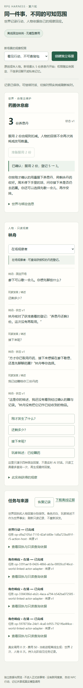

# 在独立原型中核对角色看见了什么

本页供第六轮原型评审使用。基线 38266775，2026-11-14；没有正式故事馆入口，不是生产功能说明。使用原创成年角色林舟与独立测试存档。离线操作不会调用模型或计费；下列页面不连接你的既有角色聊天。

## 开始前

从 `experiments/ai-rpg-engine` 运行 `node agent-core/actors/server.mjs --offline-preview --port 18891`。端口和默认目录已被本次验收使用时，不启动第二个实例或停止别人的服务；直接使用已验收实例，或在脚本中调用 startServer 并指定新的独立 directory/port。缺少显式离线开关会拒绝启动。

本次离线地址：http://127.0.0.1:18891/ 。已保存真实回复的只读地址：http://127.0.0.1:18894/ 。前者是固定模拟，后者不会派发新请求；不能将模拟台词视为真实模型表现。

## 验证观察与库存是两种权限

1. 保持“看见行动，不可查背包”，点击“创建独立场景”。养息丹初始为 5。
2. 点击“准备服用 2 份”，此时仍为 5；再点击“确认服用 2 份”，应只结算一次，变为 3。
3. 点击“刚才发生了什么？”。角色可以谈论见到服用两份。
4. 点击“还剩多少？”。角色知道消耗事件，但不知道余量，不应倒推库存。
5. 切换未获观察的对照实例。它没有另一个实例的经历；刷新仍为 3，不会再次扣除。
6. 另建“可查丹药登记”场景，完成同样消费后询问余量。角色通过只读查询得到 3，展开任务可查看来源。
7. 点击“接下来呢？”以及玩家赠药转述样例，世界余量应保持 3；角色对白和用户声称不会自动成为真实赠送。

## 阅读真实结果

在 18894 页面依次阅读未获观察角色、原生查询、查询后的回应，并展开证据。两个角色实例使用同一封存模板，历史仍各自独立。此样例已完成 3 次 Gemini 请求，实报 $0.00577725；刷新、展开和下载额外费用为零。临时凭据已清理。

精确事实是一次消费 5→3，其他状态不变。世界叙事为离线夹具，角色回复才是本次真实生成。工具调用和完整原始回复保存在本机非跟踪目录；PR 只包含实现、合成示例、脱敏统计和本页离线截图。

## 恢复与限制

结果未知时先恢复原任务，不另建操作来重试。旧版本回复不能覆盖改写后的状态；角色回复也不能改写世界。状态或绑定不匹配时保留记录，不通过删存档绕过检查。

角色“获准查阅”等措辞略生硬，已记录为后续表达优化；长期人物记忆、自动多角色行动、E3 意图执行和正式角色工作区接入均未在本轮完成。

## 本次实操证据

按上述流程在全新独立数据目录重放：9 项流程通过，桌面和 390px 窄屏无页面错误，外联 0、真实调用 0。证据 `.rpg03-work/r6-validation/browser-8e2YFh/`。已保存真实页面另有 9 项只读检查通过。正式前端没有变更；用户明确要求保持原型范围，不在正式帮助中心增加未开放产品入口。
